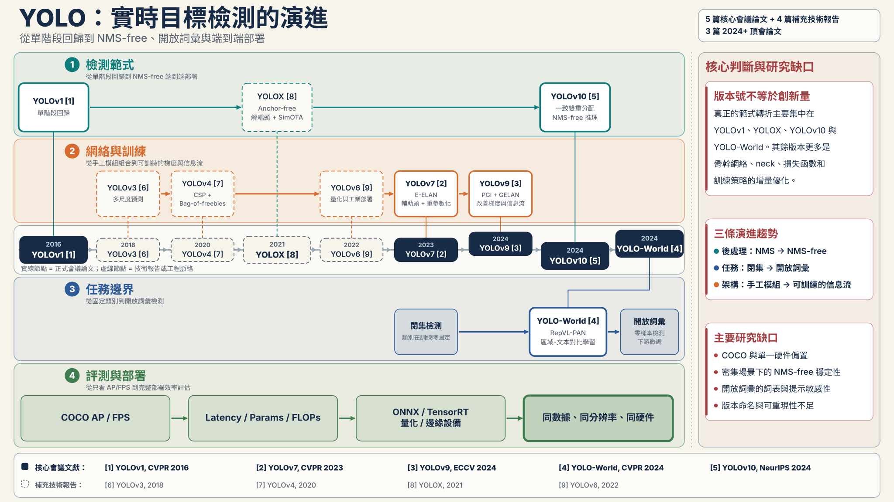
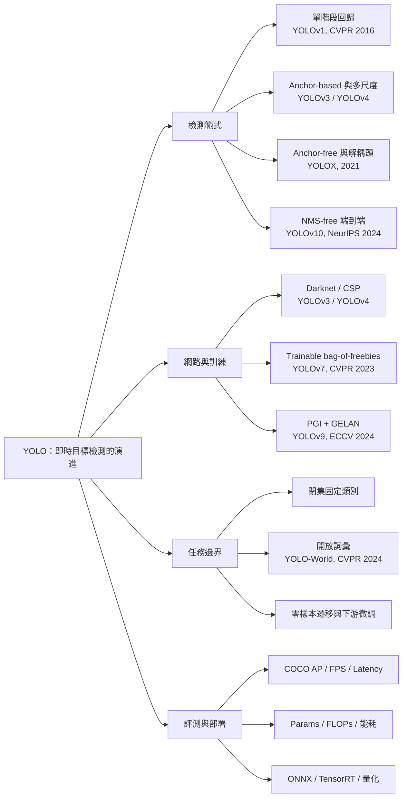

# 累積式大作業 ①：YOLO 系列目標檢測演進

**選題方向：** YOLO 系列目標檢測演進  
**文獻檢索日期：** 2026-11-13  
**核心文獻：** 5 篇正式會議論文；另外補充 4 篇技術報告作為脈絡材料  
**2024+ 頂會論文：** 3 篇（ECCV 2024、CVPR 2024、NeurIPS 2024）

> 說明：YOLO 社群中的版本命名並不總與學術發表同步。為避免把工程版本誤當成同儕審查論文，本綜述以可核驗的正式會議論文為核心，並把 YOLOv3、YOLOv4、YOLOX、YOLOv6 等技術報告作為補充脈絡。所有書目資訊均以 DOI、Crossref、OpenAlex 與 arXiv 核對。

[打開知識圖譜 PDF](YOLO任务一_知识图谱.pdf)

## 1. 選題與綜述問題

### 1.1 檢索與篩選方法

- **檢索來源：** OpenAlex（書目與引用資訊）、Crossref（DOI 與會議卷資訊）、arXiv（摘要與技術報告全文）。
- **檢索詞：** `YOLO`、`real-time object detection`、`YOLOv7`、`YOLOv9`、`YOLOv10`、`YOLO-World`。
- **納入標準：** 正式發表於電腦視覺或機器學習頂會；代表關鍵方法轉折；有可核驗的 DOI 或 arXiv 編號；結果可與原論文對照。
- **排除標準：** 僅把 YOLO 當作應用工具、缺乏方法貢獻的領域應用論文；重複或無法核驗的版本；沒有正式論文支撐的工程版本不作為核心學術證據。
- **最終樣本：** 5 篇核心會議論文（YOLOv1、YOLOv7、YOLOv9、YOLO-World、YOLOv10），加上 4 篇技術報告（YOLOv3、YOLOv4、YOLOX、YOLOv6）作為補充脈絡。

YOLO 是最具代表性的即時目標檢測範式之一。它的核心價值不是單一網路結構，而是持續在**精度、延遲、部署成本與任務邊界**之間重新定義平衡點。本綜述圍繞四個問題展開：

1. YOLO 的檢測範式經歷了哪些真正具有方法論意義的轉折？
2. 精度與速度的交換關係如何隨網路設計、標籤分配與後處理方式改變？
3. YOLO 如何從固定類別的閉集檢測，走向開放詞彙與端到端部署？
4. 現有研究的共同盲點是什麼，哪些問題仍缺乏可信的比較證據？

## 2. 結構化知識圖譜

**圖譜解讀：** YOLO 的演進可分成四條主線。第一條是檢測範式，從單階段回歸逐步走向 anchor-free 與 NMS-free；第二條是網路與訓練，重點由手工模組堆疊轉向梯度資訊與可訓練性；第三條是任務邊界，從固定類別扩展到開放詞彙；第四條是評測與部署，從只看 AP/FPS 擴展到延遲、參數量、FLOPs 與硬體相容性。

## 3. 五篇核心文獻比較

| 編號 | 論文與發表 | 核心問題 | 關鍵方法 | 主要結果或主張 | 主要限制 | 在演進中的角色 |
|---|---|---|---|---|---|---|
| [1] | *You Only Look Once: Unified, Real-Time Object Detection*，CVPR 2016 | 如何把檢測從多階段流程變成單一網路 | 將邊界框與類別機率統一為回歸問題；整張圖只做一次前向傳播 | 基礎模型 45 FPS；Fast YOLO 155 FPS；即時性顯著提升 | 定位誤差較大；小物件與重疊物件表現受限 | 建立「單階段、端到端回歸」範式 |
| [2] | *YOLOv7: Trainable Bag-of-Freebies Sets New State-of-the-Art for Real-Time Object Detectors*，CVPR 2023 | 如何在不增加推理成本的前提下提升精度 | E-ELAN、輔助頭、重參數化與可訓練 bag-of-freebies | 30 FPS 以上可達 56.8% AP；YOLOv7-E6 在 V100 上 56 FPS、55.9% AP | 主要在 COCO 上驗證；模組與訓練技巧較多，重現成本高 | 把「訓練期技巧」系統化，代表精度-速度工程優化路線 |
| [3] | *YOLOv9: Learning What You Want to Learn Using Programmable Gradient Information*，ECCV 2024 | 深層網路特徵提取中的資訊瓶頸與梯度退化 | Programmable Gradient Information（PGI）與 GELAN | 作者報告 PGI 可改善從零訓練模型的資訊保留與參數效率 | 結論主要來自 COCO；PGI 的通用性仍需跨任務驗證 | 從「堆模組」轉向「改善梯度與資訊流」 |
| [4] | *YOLO-World: Real-Time Open-Vocabulary Object Detection*，CVPR 2024 | 如何讓 YOLO 檢測訓練時未見過的類別 | RepVL-PAN 與區域-文本對比損失；大規模視覺-語言預訓練 | LVIS 上 35.4 AP、V100 上 52 FPS；支援零樣本與下游微調 | 依賴文字編碼器與大規模預訓練；詞彙/提示設計會影響結果 | 把 YOLO 從閉集檢測推向開放詞彙 |
| [5] | *YOLOv10: Real-Time End-to-End Object Detection*，NeurIPS 2024 | NMS 後處理造成延遲，且架構存在計算冗餘 | 一致雙重標籤分配實現 NMS-free 訓練；效率-精度導向的整體設計 | YOLOv10-S 相較 RT-DETR-R18 約 1.8 倍速度、參數與 FLOPs 約少 2.8 倍；YOLOv10-B 相較 YOLOv9-C 延遲低 46%、參數少 25% | NMS-free 在密集場景與不同硬體上的穩健性仍需獨立驗證 | 推進真正的端到端即時檢測與部署效率 |

## 4. 補充脈絡：從 YOLOv3 到 YOLOv6

以下四篇主要是技術報告，不計入「正式頂會核心文獻」，但能補足方法演進：

- **YOLOv3（2018）**：引入多尺度預測與 logistic 分類，提升小物件檢測；在 320×320 輸入下 22 ms、28.2 mAP，在 Titan X 上以 51 ms 達到 57.9 mAP@50。代表 YOLO 從單一尺度走向多尺度表徵。
- **YOLOv4（2020）**：系統化組合 CSP、CmBN、SAT、Mish、Mosaic、CIoU 等技巧，在 V100 上以約 65 FPS 達到 43.5% AP。代表「bag-of-freebies」與工程組合策略的成熟。
- **YOLOX（2021）**：改為 anchor-free、解耦頭與 SimOTA 標籤分配；YOLOX-L 在 V100 上以 68.9 FPS 達到 50.0% AP。這是 YOLO 系列從 anchor-based 轉向 anchor-free 的關鍵節點。
- **YOLOv6（2022）**：面向工業部署，整合量化與多硬體優化；YOLOv6-S 在 T4 上達到 43.5% AP、495 FPS。它反映研究重點從「論文指標」轉向「部署吞吐量」。

此外，YOLOv5、YOLOv8、YOLOv11 等版本在實務中使用廣泛，但主要以官方程式庫與工程文檔傳播，並非都可作為同儕審查論文引用。這種「學術論文與工程版本不同步」是 YOLO 研究的一個重要現象。

## 5. 演進主線

| 階段 | 代表工作 | 主要變化 | 為什麼重要 |
|---|---|---|---|
| 2016 | YOLOv1 | 單一網路直接回歸框與類別 | 建立即時單階段檢測範式 |
| 2018 | YOLOv3 | 多尺度預測、logistic 分類 | 改善小物件與多尺度物件 |
| 2020 | YOLOv4 | CSP、Mosaic、CIoU、訓練技巧組合 | 把精度提升工程化、系統化 |
| 2021 | YOLOX | Anchor-free、解耦頭、SimOTA | 移除 anchor 設計負擔，改善標籤分配 |
| 2022 | YOLOv6 | 量化、部署與硬體優化 | 將吞吐量與工業部署納入核心目標 |
| 2023 | YOLOv7 | E-ELAN、輔助頭、重參數化 | 證明訓練期技巧可轉化為推理收益 |
| 2024 | YOLOv9 | PGI、GELAN | 從架構堆疊轉向資訊與梯度流 |
| 2024 | YOLOv10 | 一致雙重分配、NMS-free | 移除 NMS 瓶頸，推進端到端部署 |
| 2024 | YOLO-World | 視覺-語言建模、開放詞彙 | 擴展 YOLO 的類別邊界與零樣本能力 |

## 6. 批判性分析

### 6.1 真正的範式轉折少於版本數量

YOLO 版本很多，但真正改變問題定義的轉折主要有四次：YOLOv1 的單階段回歸、YOLOX 的 anchor-free 與標籤分配、YOLOv10 的 NMS-free 端到端設計、YOLO-World 的開放詞彙檢測。其餘多數版本屬於骨幹網路、neck、損失函數、資料增強與訓練策略的增量優化。這意味著「版本號」不等於「方法創新量」。

### 6.2 評測過度集中於 COCO 與單一硬體

核心論文多以 COCO AP 與 V100/T4 延遲作為主要證據，但真實部署還受 batch size、輸入解析度、量化、TensorRT 版本、記憶體頻寬與能耗影響。不同論文的 FPS 往往不可直接比較，甚至同一模型在不同推論框架下也會有明顯差異。因此，僅用「FPS 更高」作為進步證據說服力有限。

### 6.3 NMS-free 不是沒有代價

YOLOv10 的一致性雙重分配減少了 NMS 後處理，但這並不代表所有場景都能無條件受益。密集物件、遮擋、極小物件與分佈外資料下，標籤分配與重複預測控制仍是關鍵。若要證明 NMS-free 的普遍優勢，需要在不同場景密度與硬體上做標準化壓力測試。

### 6.4 開放詞彙擴展了邊界，也轉移了依賴

YOLO-World 讓模型能辨識未見類別，但其能力來自視覺-語言預訓練、文字編碼器與詞彙設計。這表示它並沒有消除資料依賴，而是把依賴從「標註類別」轉移到「圖文對齊與提示工程」。在醫療、工業與遙感等專業領域，零樣本結果不能替代領域資料驗證。

### 6.5 可重現性與命名治理不足

YOLO 的多個版本由不同團隊維護，部分版本缺少完整論文、消融實驗或標準訓練配置；名稱也存在社群沿用與商業命名混用的情況。這使「YOLOvX 是否真的優於 YOLOvY」很難得到獨立、可重現的答案。對研究者而言，應優先比較**相同資料、相同輸入解析度、相同硬體與相同推論框架**下的結果。

## 7. 研究缺口與下一步

1. **標準化即時檢測評測**：建立跨 GPU、CPU、邊緣裝置的統一延遲、能耗與精度報告格式。
2. **穩健性與校準**：系統評估遮擋、小物件、長尾類別、分佈外資料與置信度校準。
3. **影片時序一致性**：目前多數結果仍是單帧檢測，對影片中的閃爍、漏檢與軌跡穩定性討論不足。
4. **訓練成本與可重現性**：報告完整訓練預算、資料增強、隨機種子與硬體配置，而不只報告最佳結果。
5. **開放詞彙的可信邊界**：研究提示敏感性、詞彙覆蓋率、負遷移與專業領域的失效模式。
6. **真正的端到端部署**：除了移除 NMS，還需比較前處理、後處理、量化與硬體編譯的整體延遲。

## 8. 結論

YOLO 的演進可以概括為三句話：**從多階段流程走向單一網路，從手工架構走向可訓練的資訊流，從閉集檢測走向開放詞彙與端到端部署。** 然而，版本繁榮不等於方法成熟；真正值得復現與比較的，是那些改變問題定義、且能在統一評測條件下驗證的節點。對後續技術復現而言，YOLOv10 或 YOLO-World 最能代表 2024 年後的研究前沿；若以工程可運行性與算力成本為優先，YOLOv7 或 YOLOv10 的小型模型更適合作為起點。

## 9. 參考文獻

### 核心文獻

[1] Redmon, J., Divvala, S., Girshick, R., & Farhadi, A. (2016). *You Only Look Once: Unified, Real-Time Object Detection*. CVPR 2016. DOI: [10.1109/CVPR.2016.91](https://doi.org/10.1109/CVPR.2016.91). arXiv: [1506.02640](https://arxiv.org/abs/1506.02640).

[2] Wang, C.-Y., Bochkovskiy, A., & Liao, H.-Y. M. (2023). *YOLOv7: Trainable Bag-of-Freebies Sets New State-of-the-Art for Real-Time Object Detectors*. CVPR 2023. DOI: [10.1109/CVPR52729.2023.00721](https://doi.org/10.1109/CVPR52729.2023.00721). arXiv: [2207.02696](https://arxiv.org/abs/2207.02696).

[3] Wang, C.-Y., Yeh, I.-H., & Liao, H.-Y. M. (2024). *YOLOv9: Learning What You Want to Learn Using Programmable Gradient Information*. ECCV 2024, Lecture Notes in Computer Science. DOI: [10.1007/978-3-031-72751-1_1](https://doi.org/10.1007/978-3-031-72751-1_1). arXiv: [2402.13616](https://arxiv.org/abs/2402.13616).

[4] Cheng, T., Song, L., Ge, Y., Liu, W., Wang, X., & Shan, Y. (2024). *YOLO-World: Real-Time Open-Vocabulary Object Detection*. CVPR 2024. DOI: [10.1109/CVPR52733.2024.01599](https://doi.org/10.1109/CVPR52733.2024.01599). arXiv: [2401.17270](https://arxiv.org/abs/2401.17270).

[5] Wang, A., Chen, H., Liu, L., Chen, K., Lin, Z., Han, J., & Ding, G. (2024). *YOLOv10: Real-Time End-to-End Object Detection*. NeurIPS 2024. DOI: [10.52202/079017-3429](https://doi.org/10.52202/079017-3429). arXiv: [2405.14458](https://arxiv.org/abs/2405.14458).

### 補充技術報告

[6] Redmon, J., & Farhadi, A. (2018). *YOLOv3: An Incremental Improvement*. arXiv: [1804.02767](https://arxiv.org/abs/1804.02767).

[7] Bochkovskiy, A., Wang, C.-Y., & Liao, H.-Y. M. (2020). *YOLOv4: Optimal Speed and Accuracy of Object Detection*. arXiv: [2004.10934](https://arxiv.org/abs/2004.10934).

[8] Ge, Z., Liu, S., Wang, F., Li, Z., & Sun, J. (2021). *YOLOX: Exceeding YOLO Series in 2021*. arXiv: [2107.08430](https://arxiv.org/abs/2107.08430).

[9] Li, C., Li, L., Jiang, H., et al. (2022). *YOLOv6: A Single-Stage Object Detection Framework for Industrial Applications*. arXiv: [2209.02976](https://arxiv.org/abs/2209.02976).
